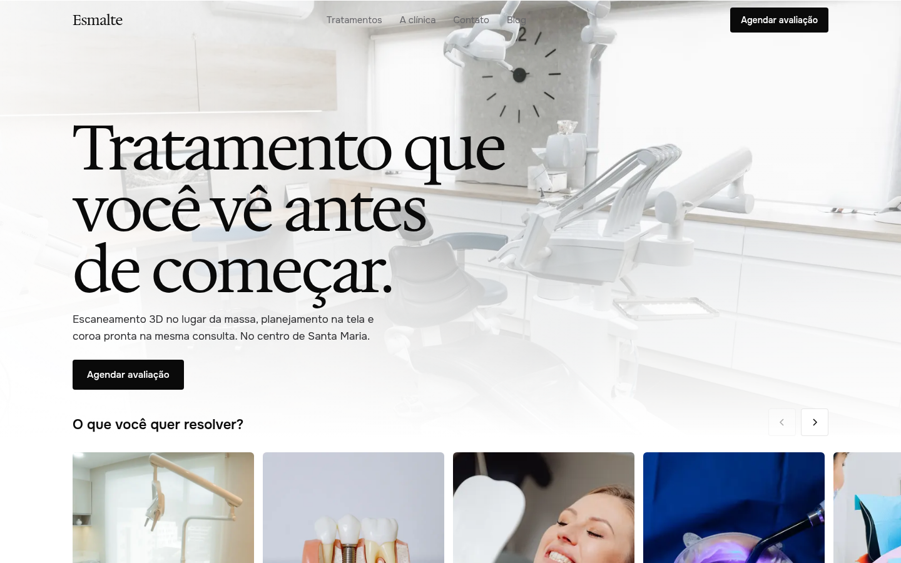
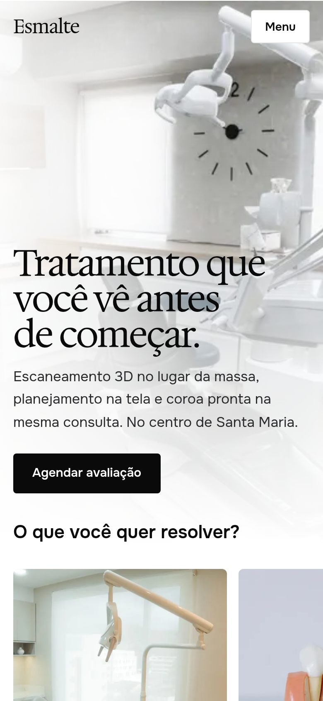
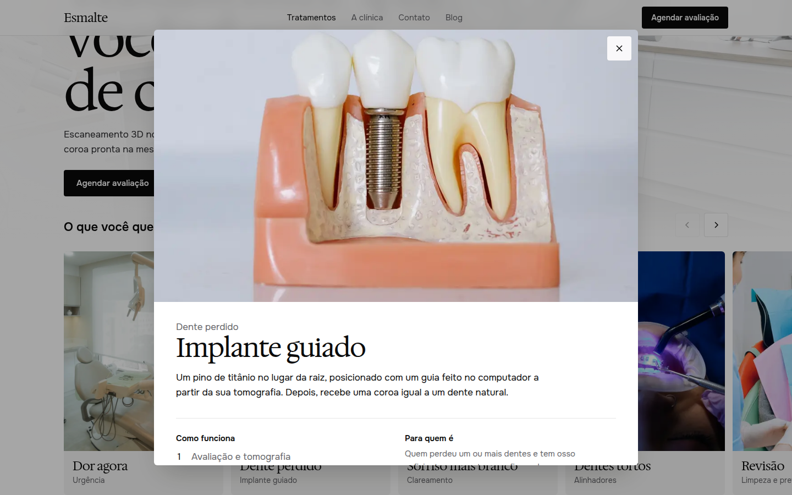
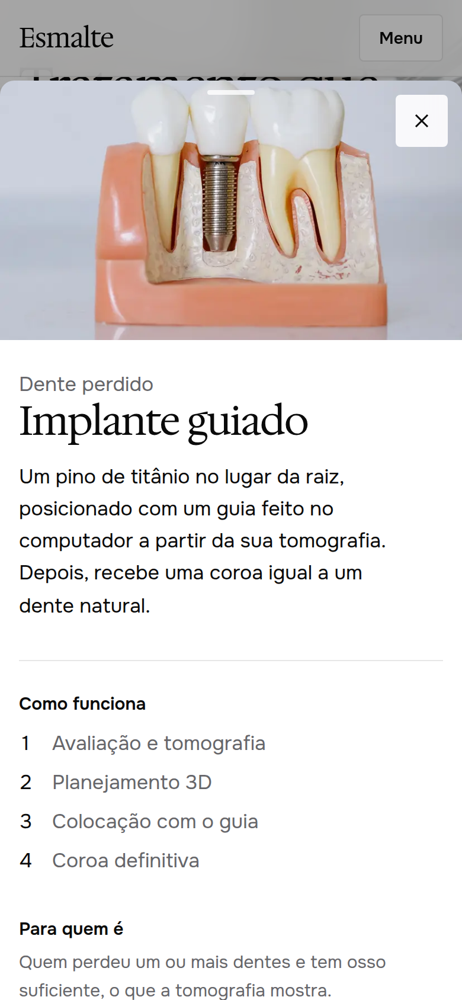

# Clínica Esmalte Odontologia

Site de uma clínica odontológica **fictícia** em Santa Maria/RS, com foco em odontologia digital.
É um projeto de demonstração, feito para portfólio (pacote Institucional).

<p>
  
  &nbsp;
  
</p>

## O que tem no site

- **Capa** com o consultório de ponta a ponta e a fileira "O que você quer resolver?" subindo sobre a foto
- **Tratamentos** em fileiras deslizantes (no celular) ou em grade (no desktop); cada cartão abre o detalhe
  **por cima da página, crescendo a partir do cartão**. O endereço muda (dá para compartilhar o link),
  o botão "voltar" fecha, e no celular a janela fecha arrastando para baixo
- **O que a tecnologia muda para você**: abas com uma **comparação arrastável** "como era / como é aqui"
- **A clínica**: equipe, história e o espaço
- **Contato**: WhatsApp, mapa (OpenStreetMap) com atalhos para Google Maps e Waze, horários, convênios,
  dúvidas frequentes e formulário
- **Blog** com textos curtos sobre saúde bucal

<p>
  
  &nbsp;
  
</p>

## Qualidade

- Acessibilidade WCAG 2.1 AA: teclado em tudo, foco visível, leitor de tela (axe sem violações)
- Lighthouse: acessibilidade, boas práticas e SEO 100
- Dados estruturados para o Google (clínica, perguntas frequentes, artigos), mapa do site e `robots.txt`
- Cabeçalhos de segurança; formulário validado no servidor, com proteção contra robôs
- Respeita a opção "reduzir movimento" do sistema
- Segue as regras de publicidade do CFO: sem preços, sem antes e depois, sem depoimentos

Todo o conteúdo (tratamentos, equipe, horários, convênios, textos) fica em `src/data/clinica.ts`.
A identidade visual e as regras de interface estão em `DESIGN.md`; o processo de criação em
`BRIEFING.md` e `ORGANIZACAO.md`.

## Feito com

- [Next.js](https://nextjs.org) 16, React 19 e TypeScript
- [Tailwind CSS](https://tailwindcss.com) 4
- [Base UI](https://base-ui.com) (janela, menu do celular, abas, comparação e dúvidas)
- Fontes Hedvig Letters Serif e Onest
- Fotos do [Pexels](https://www.pexels.com), com os créditos em `src/fotos/CREDITOS.md`

## Rodar no computador

```bash
npm install
npm run dev
```

Para o formulário enviar e-mail de verdade, crie um `.env.local` com `RESEND_API_KEY` e
`CONTATO_EMAIL`. Sem essas variáveis, ele funciona em modo demonstração.

---

Criado por Lorenzo Guerra Turchetti.
